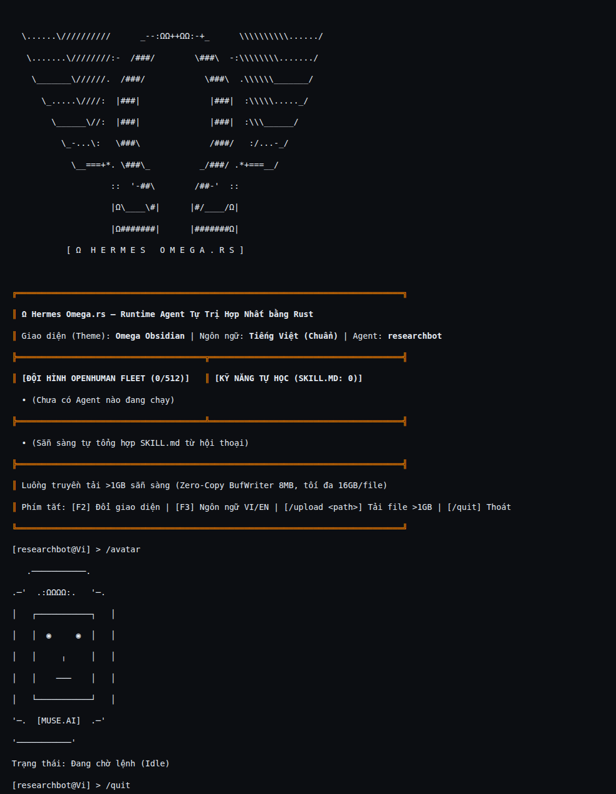
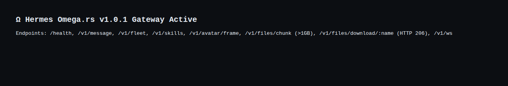

<p align="center">
  
</p>

<h1 align="center">Ω Hermes Omega.rs</h1>

<p align="center">
  <a href="https://github.com/ArtyormSatori/Hermes-Omega.rs/releases"></a>
  <a href="https://github.com/ArtyormSatori/Hermes-Omega.rs/blob/main/LICENSE"></a>
  
  <a href="https://github.com/ArtyormSatori/Hermes-Omega.rs/actions/workflows/ci.yml"></a>
</p>

<p align="center">
  <a href="#english">English</a> · <a href="#tiếng-việt">Tiếng Việt</a> · <a href="CHANGELOG.md">Changelog</a>
</p>

---

## English

**The self-improving AI agent, rewritten in Rust.** It learns from experience — creating skills, improving them during use, and remembering who you are across sessions. One static binary: run it on a VPS, a server, or your laptop. Use any model you want — xAI, Anthropic, OpenAI, Ollama, or your own endpoint.

### Screenshots

<p align="center">
  
  <br><em>Terminal UI: ASCII emblem, fleet and skills panels, Vietnamese avatar (<code>/avatar</code>)</em>
</p>

<p align="center">
  
  <br><em>Gateway dashboard at <code>http://localhost:8080/</code></em>
</p>

### Quick start

```bash
cargo build --release
./target/release/hermes-omega doctor
```

Docker:

```bash
export XAI_API_KEY="your_key" ANTHROPIC_API_KEY="your_key"
docker compose up --build -d
curl -s http://localhost:8080/health
```

### Commands

```bash
hermes-omega tui                  # Terminal UI + avatar
hermes-omega chat --agent researchbot
hermes-omega daemon --bind 0.0.0.0:8080   # Gateway + dashboard
hermes-omega security-audit       # Audit the security layers
hermes-omega fleet --benchmark-count 50
hermes-omega teach deploy-rust-service
hermes-omega skills
hermes-omega search "memory safety"
hermes-omega acp                  # ACP server for editors
hermes-omega doctor
```

### Configuration

`config.yaml` holds the gateway, LLM providers, and fleet settings. The fleet is the pool of agents running in parallel: `max_concurrent_agents: 512` is how many run at once, `agent_memory_budget_kb: 256` is the memory cap per agent. Raise the cap only on machines with enough RAM. State lives under `~/.hermes/`.

### Branding

<p align="center">
  
  <em>ASCII banner, rendered by the built-in ASCII engine</em>
</p>

<p align="center">
  
  
</p>
<p align="center"><em>ASCII emblem (left) and app icon (right)</em></p>

### Releases

See [CHANGELOG.md](CHANGELOG.md). Current: **v1.0.1**.

### Contributing & license

Issues and PRs welcome — run `cargo fmt`, `cargo clippy`, and `cargo test` first. MIT license, see [LICENSE](LICENSE).

---

## Tiếng Việt

**Agent AI tự cải thiện, viết lại bằng Rust.** Nó học từ kinh nghiệm — tự tạo kỹ năng, cải thiện kỹ năng trong lúc dùng, và nhớ bạn là ai qua các phiên. Một binary duy nhất: chạy trên VPS, máy chủ hay laptop đều được. Dùng model nào cũng được — xAI, Anthropic, OpenAI, Ollama hay endpoint của riêng bạn.

### Hình ảnh

<p align="center">
  
  <br><em>Giao diện terminal: emblem ASCII, bảng fleet và kỹ năng, avatar tiếng Việt (<code>/avatar</code>)</em>
</p>

<p align="center">
  
  <br><em>Dashboard gateway tại <code>http://localhost:8080/</code></em>
</p>

### Bắt đầu nhanh

```bash
cargo build --release
./target/release/hermes-omega doctor
```

Docker:

```bash
export XAI_API_KEY="your_key" ANTHROPIC_API_KEY="your_key"
docker compose up --build -d
curl -s http://localhost:8080/health
```

### Dòng lệnh

```bash
hermes-omega tui                  # Giao diện terminal + avatar
hermes-omega chat --agent researchbot
hermes-omega daemon --bind 0.0.0.0:8080   # Gateway + dashboard
hermes-omega security-audit       # Kiểm định các lớp bảo mật
hermes-omega fleet --benchmark-count 50
hermes-omega teach deploy-rust-service
hermes-omega skills
hermes-omega search "memory safety"
hermes-omega acp                  # Máy chủ ACP cho editor
hermes-omega doctor
```

### Cấu hình

`config.yaml` chứa gateway, nhà cung cấp LLM và cài đặt hạm đội. Hạm đội là tập hợp các agent chạy song song: `max_concurrent_agents: 512` là số agent tối đa chạy cùng lúc, `agent_memory_budget_kb: 256` là bộ nhớ tối đa mỗi agent được dùng. Chỉ tăng giới hạn khi máy đủ RAM. Dữ liệu lưu tại `~/.hermes/`.

### Phiên bản

Xem [CHANGELOG.md](CHANGELOG.md). Hiện tại: **v1.0.1**.

### Đóng góp & giấy phép

Mời gửi issue và pull request — chạy `cargo fmt`, `cargo clippy` và `cargo test` trước. Giấy phép MIT, xem [LICENSE](LICENSE).
