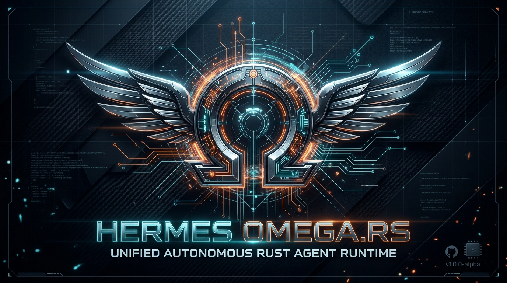
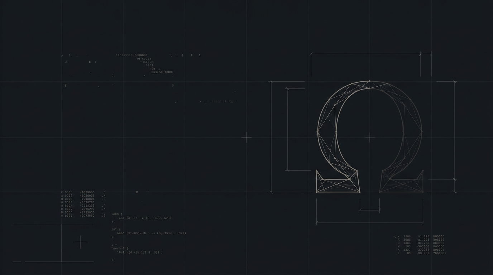
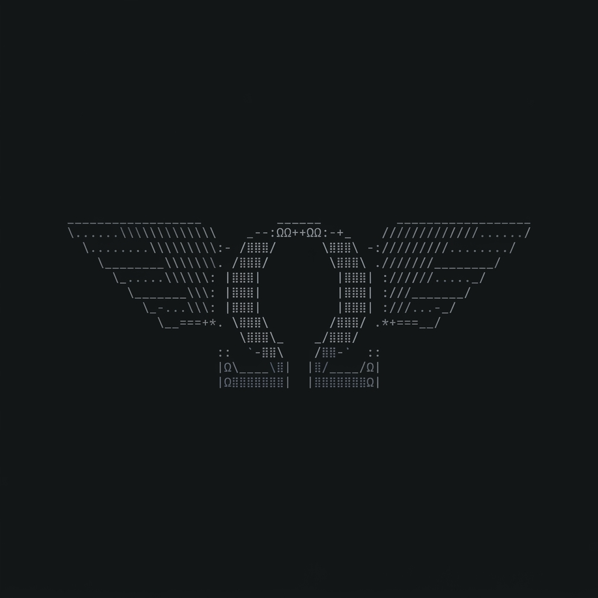
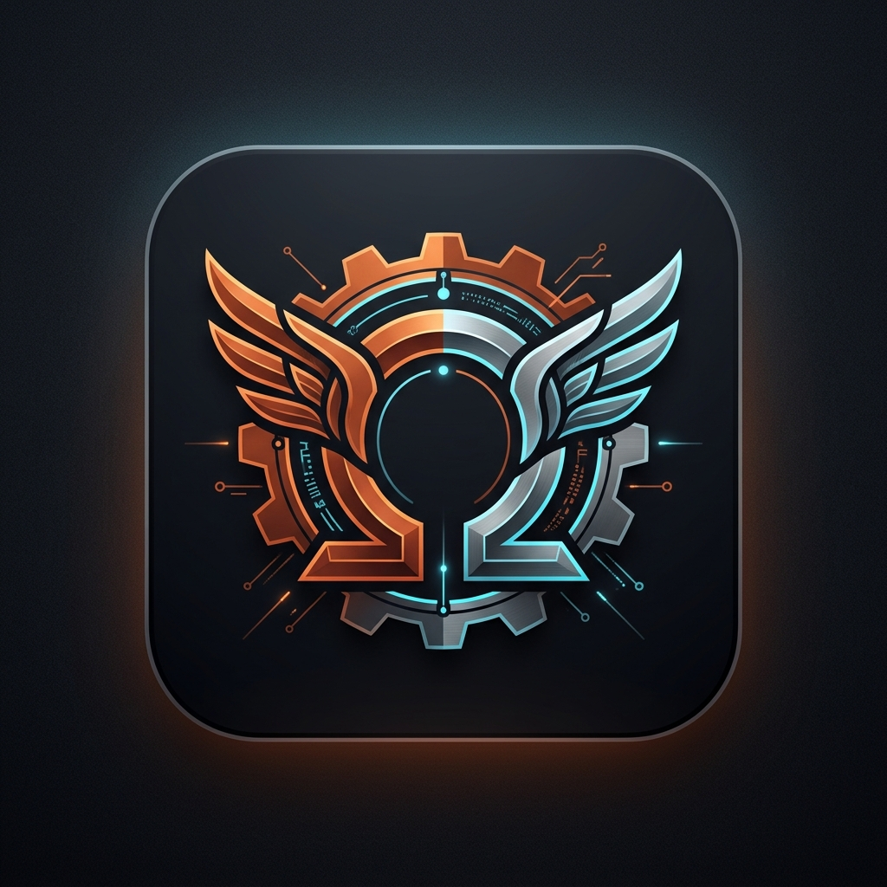

<p align="center">
  
</p>

<h1 align="center">Ω Hermes Omega.rs</h1>

<p align="center">
  <a href="https://github.com/ArtyormSatori/Hermes-Omega.rs/releases/tag/v1.0.1"></a>
  <a href="https://github.com/ArtyormSatori/Hermes-Omega.rs/blob/main/LICENSE"></a>
  
  <a href="https://github.com/ArtyormSatori/Hermes-Omega.rs/actions/workflows/ci.yml"></a>
</p>

<p align="center">
  <b>Unified autonomous AI agent runtime in Rust.</b><br>
  <i>Runtime agent tự trị hợp nhất viết bằng Rust — một binary, nhiều cơ chế, hai ngôn ngữ.</i>
</p>

<p align="center">
  <a href="#english">English</a> · <a href="#tiếng-việt">Tiếng Việt</a> · <a href="CHANGELOG.md">Changelog</a>
</p>

---

## English

### What it is

Hermes Omega.rs re-architects the **Nous Hermes** agent into a single static Rust binary, integrating the runtime mechanisms of **OpenClaw**, **OpenHands**, **OpenHuman**, and **Grokbot** — plus a realtime Vietnamese avatar (**MUSE.AI**) and a 6-layer security shield.

| Capability | Module | Mechanism |
|---|---|---|
| 3-tier prompt & memory | `hermes_core` | Prefix-cache-aligned system prompt; SQLite WAL + FTS5 full-text search (Vietnamese, `unicode61 remove_diacritics`); closed skill loop writing `SKILL.md`; ShareGPT trajectory export |
| Event stream & condenser | `event_stream` | Typed `Action` → `Observation` event stream (1024-slot `tokio::broadcast`); `ContextCondenser` keeps head/tail, summarizes the middle |
| Multi-channel gateway | `claw_gateway` | Axum HTTP/WebSocket; DM pairing (constant-time verification); 30-min proactive heartbeat; >1 GB–16 GB chunked upload & `Range` download; web dashboard at `/` and `/dashboard` |
| Fleet harness & memory tree | `human_harness` | Lock-free `DashMap` fleet — many agents running in parallel in one process; 20-min memory-tree wiki sync; 4-tier risk classifier (`Low`–`Critical`) |
| Role inference & LLM router | `grok_engine` | Deterministic role inference from agent name; `TeachATaskRecorder` → `SKILL.md`; multi-provider fallback (xAI, Anthropic, OpenAI, Nous, Ollama) |
| Sandbox & tools | `sandbox`, `tools` | Local / Docker (`--network none --memory 512m`) / SSH / Firecracker; shell-injection audit; env isolation; JSON-Schema tool registry |
| IDE protocol | `acp` | Stdio JSON-RPC 2.0 server for VS Code, Zed, JetBrains |
| Avatar & TUI | `avatar`, `ascii_art`, `tui`, `i18n` | Realtime Vietnamese viseme lip-sync avatar; multi-theme terminal UI; `Locale::Vi` |

**Fleet limits** (`config.yaml` → `openhuman`): the fleet is the pool of agents running in parallel. `max_concurrent_agents: 512` caps how many agents run at once; `agent_memory_budget_kb: 256` caps the memory each agent may use; `memory_tree_sync_interval_secs: 1200` sets how often the memory-tree wiki syncs. Raise `max_concurrent_agents` only on machines with enough RAM.

### Security — 6 layers

`security` + `large_transfer`: prompt-injection shield (canary token, cryptographic spotlighting, Unicode stripper) · SQL/FTS5 injection guard (`rusqlite::params!`, `PRAGMA trusted_schema = OFF`, FTS5 sanitizer) · path-traversal jail · constant-time HMAC-SHA256 verification · shell-command auditor · sliding-window rate limiter.

### Screenshots

<p align="center">
  
  <em>ASCII banner (monochrome, rendered by <code>ascii_art</code>)</em>
</p>

<p align="center">
  
  
</p>
<p align="center"><em>ASCII emblem (left) and app icon (right)</em></p>

### Quick start

```bash
cargo test -- --nocapture
cargo build --release
./target/release/hermes-omega doctor
```

Docker:

```bash
export XAI_API_KEY="your_key" ANTHROPIC_API_KEY="your_key"
docker compose up --build -d
curl -s http://localhost:8080/health
```

### CLI

```bash
hermes-omega tui                  # Multi-theme TUI + MUSE.AI avatar
hermes-omega chat --agent researchbot
hermes-omega daemon --bind 0.0.0.0:8080   # Gateway + dashboard + heartbeat
hermes-omega security-audit       # Audit all 6 security layers
hermes-omega fleet --benchmark-count 50
hermes-omega teach deploy-rust-service
hermes-omega skills
hermes-omega search "memory safety"
hermes-omega acp                  # ACP server for editors
hermes-omega doctor
```

Config: `config.yaml` — gateway, LLM providers, and the OpenHuman fleet limits (see above). State lives under `~/.hermes/` (`SOUL.md`, `MEMORY.md`, `USER.md`, SQLite DB).

### Releases

See [CHANGELOG.md](CHANGELOG.md). Current: **v1.0.1** (2026-11-06). Previous: v1.0.0, v0.8.0-sec, v0.5.0.

### Contributing & license

Issues and PRs are welcome. Please run `cargo fmt`, `cargo clippy`, and `cargo test` before submitting. MIT license — see [LICENSE](LICENSE).

---

## Tiếng Việt

### Hermes Omega.rs là gì

Hermes Omega.rs tái cấu trúc agent **Nous Hermes** thành một binary Rust duy nhất, tích hợp cơ chế runtime của **OpenClaw**, **OpenHands**, **OpenHuman** và **Grokbot** — cộng thêm avatar tiếng Việt thời gian thực (**MUSE.AI**) và hệ thống bảo vệ 6 lớp.

| Năng lực | Module | Cơ chế |
|---|---|---|
| Prompt 3 tầng & bộ nhớ | `hermes_core` | System prompt tối ưu cho prefix-cache; SQLite WAL + FTS5 tìm kiếm toàn văn tiếng Việt (`unicode61 remove_diacritics`); vòng lặp học khép kín ghi `SKILL.md`; xuất lịch sử hội thoại dạng ShareGPT |
| Luồng sự kiện & cô đọng | `event_stream` | Luồng sự kiện `Action` → `Observation` (1024 slot `tokio::broadcast`); `ContextCondenser` giữ đầu/cuối, tóm tắt đoạn giữa |
| Cổng đa kênh | `claw_gateway` | HTTP/WebSocket (Axum); ghép đôi DM (xác thực bằng so sánh hằng số thời gian); heartbeat 30 phút; upload/download >1 GB–16 GB theo từng khối (chunk) và `Range`; dashboard web tại `/` và `/dashboard` |
| Hạm đội & cây tri thức | `human_harness` | Hạm đội lock-free `DashMap` — nhiều agent chạy song song trong một tiến trình; đồng bộ wiki cây tri thức mỗi 20 phút; bộ phân loại rủi ro 4 tầng (`Low`–`Critical`) |
| Suy luận vai trò & router LLM | `grok_engine` | Suy luận vai trò từ tên agent; `TeachATaskRecorder` → `SKILL.md`; fallback đa nhà cung cấp (xAI, Anthropic, OpenAI, Nous, Ollama) |
| Sandbox & công cụ | `sandbox`, `tools` | Local / Docker (`--network none --memory 512m`) / SSH / Firecracker; kiểm duyệt lệnh shell; cô lập biến môi trường; registry công cụ JSON-Schema |
| Giao thức IDE | `acp` | Máy chủ JSON-RPC 2.0 qua stdio cho VS Code, Zed, JetBrains |
| Avatar & TUI | `avatar`, `ascii_art`, `tui`, `i18n` | Avatar khẩu hình tiếng Việt thời gian thực; TUI đa chủ đề; `Locale::Vi` |

**Giới hạn hạm đội là gì?** Hạm đội (fleet) là tập hợp các agent chạy song song trong một tiến trình. Trong `config.yaml` → mục `openhuman`: `max_concurrent_agents: 512` là số agent tối đa được chạy cùng lúc; `agent_memory_budget_kb: 256` là bộ nhớ tối đa mỗi agent được dùng; `memory_tree_sync_interval_secs: 1200` là chu kỳ đồng bộ wiki cây tri thức (20 phút). Chỉ tăng `max_concurrent_agents` khi máy đủ RAM.

### Bảo mật — 6 lớp

`security` + `large_transfer`: chống prompt-injection (canary token, spotlighting mật mã, lọc Unicode) · chống SQL/FTS5 injection (`rusqlite::params!`, `PRAGMA trusted_schema = OFF`, bộ lọc FTS5) · chặn path-traversal · xác thực HMAC-SHA256 bằng so sánh hằng số thời gian · kiểm duyệt lệnh shell · giới hạn tốc độ gọi theo cửa sổ trượt.

### Hình ảnh demo

<p align="center">
  
  <em>Banner ASCII (đơn sắc, do <code>ascii_art</code> vẽ)</em>
</p>

<p align="center">
  
  
</p>
<p align="center"><em>Emblem ASCII (trái) và icon ứng dụng (phải)</em></p>

### Bắt đầu nhanh

```bash
cargo test -- --nocapture
cargo build --release
./target/release/hermes-omega doctor
```

Docker:

```bash
export XAI_API_KEY="your_key" ANTHROPIC_API_KEY="your_key"
docker compose up --build -d
curl -s http://localhost:8080/health
```

### Dòng lệnh

```bash
hermes-omega tui                  # TUI đa chủ đề + avatar MUSE.AI
hermes-omega chat --agent researchbot
hermes-omega daemon --bind 0.0.0.0:8080   # Gateway + dashboard + heartbeat
hermes-omega security-audit       # Kiểm định 6 lớp bảo mật
hermes-omega fleet --benchmark-count 50
hermes-omega teach deploy-rust-service
hermes-omega skills
hermes-omega search "memory safety"
hermes-omega acp                  # Máy chủ ACP cho editor
hermes-omega doctor
```

Cấu hình: `config.yaml` — gồm gateway, nhà cung cấp LLM, và giới hạn hạm đội OpenHuman (xem giải thích ở trên). Dữ liệu lưu tại `~/.hermes/` (`SOUL.md`, `MEMORY.md`, `USER.md`, SQLite DB).

### Phiên bản

Xem [CHANGELOG.md](CHANGELOG.md). Hiện tại: **v1.0.1** (06/11/2026). Các bản trước: v1.0.0, v0.8.0-sec, v0.5.0.

### Đóng góp & giấy phép

Mời gửi issue và pull request. Vui lòng chạy `cargo fmt`, `cargo clippy` và `cargo test` trước khi gửi. Giấy phép MIT — xem [LICENSE](LICENSE).
